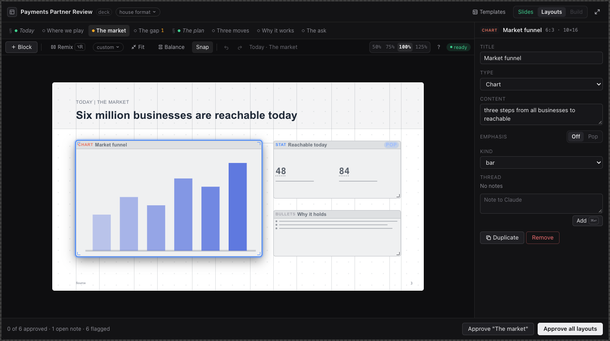
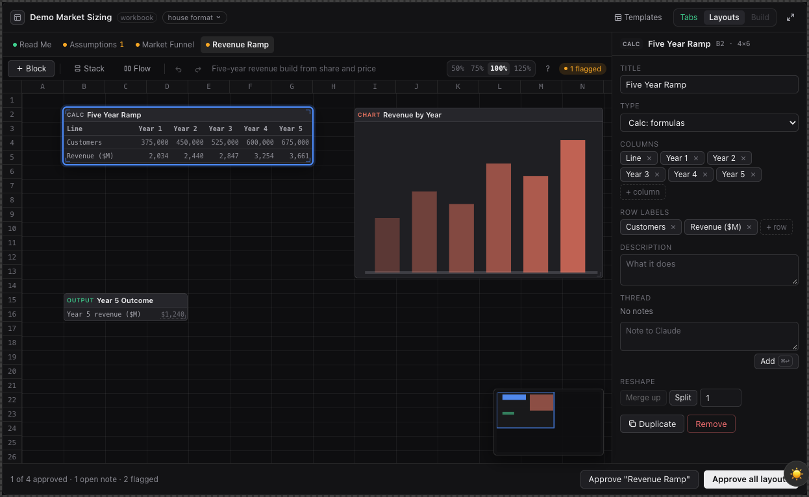

# Blueprint

An MCP App for Claude Desktop: you plan a workbook (.xlsx) or a deck (.pptx) on a canvas inside the chat, approve it, and then Claude builds the real file from the plan you approved.



I built this because asking Claude for a spreadsheet or a deck in one shot kept giving me something close but wrong in ways that were slow to fix after the fact. The tab order was off, or a chart sat where a table should be. Arguing about structure is much cheaper before anything is built, so Blueprint makes the structure the thing you review.

## How it works

There are three layers, and you approve each one before Claude moves on:

1. **Outline.** Claude proposes the tabs or slides. You drag rows to reorder, rename them in place and leave notes.
2. **Layouts.** Claude puts blocks on a grid for each tab or slide (inputs, calcs, tables, charts, stats, bullets, diagrams). You drag and resize them, edit columns and line items, and answer Claude's questions.
3. **Build.** Claude closes every open note, then the Python builder writes the file. The Built view shows a preview, a plan-vs-build diff and the formula check.

Notes are threads on a row or block. Your instructions and Claude's questions live in the same place, and the build refuses to run while any thread is still open.

```
Claude Desktop chat
   │  MCP tools over stdio (start_project, propose_outline, propose_layouts, build_deck ...)
   ▼
Node server (src/server)  ──  plan JSON in ~/.blueprint/projects/<id>.json
   │                                 ▲
   │  ui:// resource                 │  ui_save_layout, ui_note, ui_approve (canvas-only tools)
   ▼                                 │
Canvas (src/app, bundled by Vite into one HTML file, rendered inline in the chat)
   │
   │  approved plan
   ▼
Python builder (builder/)  ──  openpyxl for .xlsx, python-pptx for .pptx
   │
   ▼
LibreOffice (optional): recalculates the workbook, renders slide PNGs and a PDF
```

The server never calls a model. Everything runs locally and the thinking happens in your Claude Desktop chat.



Styles come from four places: plain, the built-in house format (Arial 10, blue inputs, black formulas, a Read Me cover), any formatting skill in `~/.claude/skills`, or a template file you hand it. `extract_format` can also derive a style from your own .xlsx or .pptx and save it as a skill. `builder/styles/harbor_deck.json` is a sample skill format the tests build against.

## Running it

You need Node 20 or newer, Python 3 with `pip3 install openpyxl python-pptx`, and Claude Desktop on macOS. LibreOffice is optional.

```bash
git clone https://github.com/Joconnell04/blueprint && cd blueprint
npm install
npm run bundle        # builds the server and canvas, then writes blueprint.mcpb
```

Then in Claude Desktop, go to Settings > Extensions and drag `blueprint.mcpb` onto the drop zone. Set the output folder and the Python path in the extension's settings if the defaults are wrong. Quit Claude Desktop with Cmd+Q and start a new chat; the canvas is cached by resource URI, so an old chat keeps showing the old canvas. The first time a canvas renders, click "Always allow".

If there is a release on the Releases page, you can download its `.mcpb` and skip the build.

To try a workbook, say: "Plan a workbook with Blueprint: market sizing model for a B2B payments product, house format." Claude asks two to five questions, the brief card fills in, and the outline canvas appears. For a deck: "Plan a deck with Blueprint: Q3 board update for the investors." On a small job you can say "skip layouts" and it builds from the approved outline.

Built files land in `~/Documents/Blueprint`. Plans, templates and styles live in `~/.blueprint`.

| Tool | What it does |
|---|---|
| `start_project` | create a workbook or deck plan |
| `propose_outline` | set the ordered tabs or slides and render the canvas |
| `propose_layouts` | set blocks, positions, content and questions for one or more rows |
| `update_plan` | apply edits from the chat |
| `get_plan` | read the plan with hand edits, open threads and warnings |
| `resolve_notes` | close a thread with what was done, or decline it with a reason |
| `build_workbook`, `build_deck` | build the file from the approved plan, plus checks and images |
| `review_workbook`, `review_deck` | sheet or slide images of the last build, with findings |
| `import_workbook`, `import_deck` | scan an existing file into a plan, block by block |
| `extract_format` | derive a formatting skill from example files |
| `restyle_workbook` | reformat an imported workbook without touching values or formulas |
| `save_template`, `list_templates`, `apply_template` | reuse an approved plan |
| `show_plan`, `list_projects` | reopen a plan in a new chat |

The canvas also calls nine `ui_*` tools that the model never sees.

| Variable | What it does |
|---|---|
| `BLUEPRINT_HOME` | where plans live (default `~/.blueprint`) |
| `BLUEPRINT_OUTPUT` | where built files go (default `~/Documents/Blueprint`) |
| `BLUEPRINT_PYTHON` | Python with openpyxl and python-pptx |
| `BLUEPRINT_SKILLS` | skills folder to read styles from |
| `BLUEPRINT_SOFFICE` | path to LibreOffice's `soffice` |

## Developing

```bash
npm run build                          # server (tsc) and canvas (vite, one HTML file)
npm test                               # Python builders, stdio flows, layout units, Playwright
npm run dev:ui                         # rebuild the canvas on change
node dist/server/main.js --http 3001   # HTTP mode for the ext-apps basic host
```

The Playwright suite needs Chromium once (`npx playwright install chromium`). It starts its own server and host and writes failure screenshots to `test/e2e/artifacts`.

`docs/design.md` covers the architecture, `builder/SPEC.md` and `builder/SPEC-deck.md` the build payloads, `docs/skill-format-block.md` the `format:` block a skill uses to describe a style, and `docs/VERIFY.md` a manual check to run in Claude Desktop after an install.

## What's rough

- Do not hand-edit `claude_desktop_config.json` for this server. Claude Desktop rewrites that file on quit and drops entries it did not load itself.
- Without LibreOffice there's no recalculation before the formula check, and no slide PNGs or PDF.
- The canvas is cached per resource URI, so after an update you have to start a new chat to see it.
- Font handling assumes the faces are installed. A style that names a font you don't have falls back to Arial and the build says so.
- Some code comments cite design notes under `docs/research/` that I kept private because they were written against real work files.
- macOS only so far; the bundle manifest says `darwin`.
